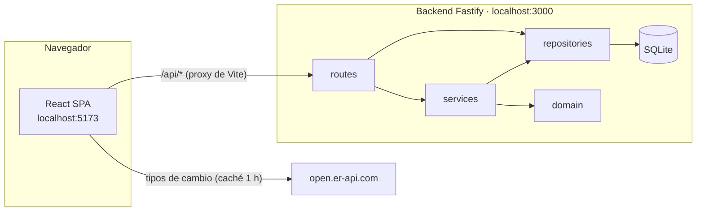
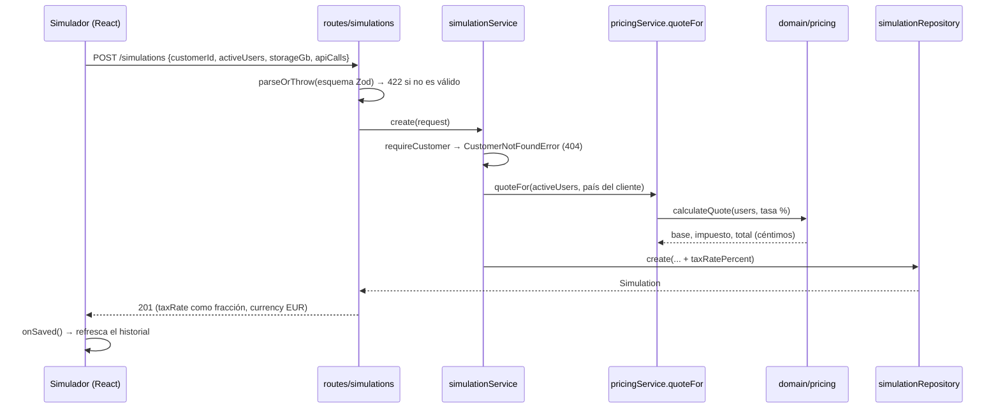

# Arquitectura

Visión general de cómo está organizado SaaS-O-Matic y por qué. El modelo de datos está en [modelo-datos.md](modelo-datos.md) y el registro de decisiones, en [decisiones.md](decisiones.md).

## Vista general



- **El frontend nunca calcula precios.** Pide cada presupuesto al backend (`GET /pricing/preview`) y solo convierte de divisa al mostrar.
- **El proxy de Vite** reenvía `/api/*` al backend quitando el prefijo: no hace falta CORS, y las rutas del SPA (`/customers/:id`) no chocan con las de la API.

## Backend: capas

| Capa | Responsabilidad | Puede usar | Nunca |
|---|---|---|---|
| `routes/` | HTTP: valida la entrada (Zod), llama y responde | `services`, `repositories`, `domain`, `http` | SQL, cálculos de negocio |
| `http/` | Formato de error común y helper de validación | — | Lógica de negocio |
| `services/` | Casos de uso que combinan repositorios y dominio | `repositories`, `domain`, `config` | Conceptos HTTP |
| `domain/` | Reglas puras: tramos, impuesto, DNI/NIE/CIF | `config` | BD, red, reloj |
| `repositories/` | Único sitio con SQL de datos (parametrizado) | `db`, `domain` (normalización) | Reglas de negocio |
| `db/` | Conexión, función `fold` y migraciones (esquema) | — | Datos de negocio |
| `config/` | Tasas, tramos, límites, planes y entorno | — | Lógica |

**Los errores fluyen hacia arriba como tipos propios** y solo `http/errors.ts` los traduce a HTTP:

| Error | Lo lanza | HTTP |
|---|---|---|
| `ValidationError` | rutas (Zod) | 422 |
| `CustomerNotFoundError` | servicio o ruta | 404 |
| `DuplicateTaxIdError` | repositorio (restricción `UNIQUE`) | 409 |
| Errores de Fastify (JSON mal formado, cuerpo enorme…) | Fastify | 422 |
| Cualquier otro | — | 500 genérico; el detalle solo va al log |

### Flujo: guardar una simulación



La **vista previa** (`GET /pricing/preview`) usa la misma `quoteFor`, así que el número que ve el comercial en el deslizador es exactamente el que se guarda.

## Frontend

```
src/
  api/          request<T> (único acceso al backend), un fichero por recurso, tipos del contrato
  config/       divisas, búsqueda y simulador (constantes con nombre)
  hooks/        useAsync, useDebouncedValue, usePricingPreview, useExchangeRates, useCurrency…
  features/     una carpeta por vista: customers/, customer-detail/, simulator/, currency/, not-found/
  components/   Layout, Card, FormField, estados (Loading, ErrorMessage, EmptyState), selector de divisa
  utils/        formato con Intl, caché de tipos de cambio, nombres de país y plan, mensajes de error
```

**Piezas clave:**
- **`useAsync(load, key)`:** toda carga de datos pasa por aquí.
  - estados `loading`/`success`/`error`, con `retry`;
  - cancela la petición anterior y descarta su respuesta si llega tarde;
  - conserva los datos mientras recarga, sin parpadeos;
  - solo recarga cuando cambia `key`, así que una función inline no provoca bucles.
- **`CurrencyProvider`:** la divisa global. Si no hay tipo de cambio para la divisa elegida, usa EUR. Expone `formatCents`, así que todas las vistas formatean igual y cambiar de divisa no vuelve a pedir datos.
- **Validación:** el frontend no repite las reglas. Envía lo escrito y muestra junto a cada campo el mensaje en español que devuelve el backend (422).
- **Accesibilidad:**
  - enlace de salto y `<main>` que recibe el foco al navegar;
  - regiones con nombre;
  - `aria-invalid` y `aria-describedby` en los campos;
  - foco en el primer error tras enviar;
  - contraste ≥ WCAG AA, comprobado con `axe-core` en los tests.

## Pruebas

| Nivel | Dónde | Qué cubre |
|---|---|---|
| Dominio | `backend/tests/*.test.ts` | Los 8 casos de tramos de la spec y DNI/NIE/CIF válidos e inválidos |
| BD y repositorios | `backend/tests/db`, `repositories` | Esquema, restricciones, migraciones idempotentes, búsqueda con tildes |
| HTTP | `backend/tests/routes`, `http` | Cada endpoint con 2xx, 404, 409 y 422, y formato de error |
| Frontend | `frontend/src/**/*.test.ts(x)` | Hooks, cliente de API, pantallas con API simulada y `axe-core` |
| Punta a punta | `frontend/e2e/` | La app React completa contra el backend real compilado, por HTTP |

`npm test` (desde la raíz) ejecuta los cuatro primeros niveles, en backend y frontend. La prueba de punta a punta va aparte con `npm run test:e2e`, porque necesita el backend compilado.
