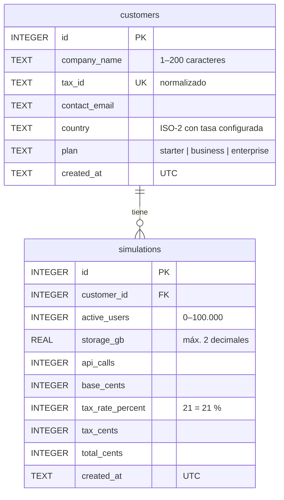

# Modelo de datos

SQLite con `better-sqlite3`. El esquema vive en `backend/src/db/migrations/` y se aplica solo al arrancar.



```sql
CREATE TABLE customers (
  id            INTEGER PRIMARY KEY AUTOINCREMENT,
  company_name  TEXT NOT NULL,
  tax_id        TEXT NOT NULL UNIQUE,
  contact_email TEXT NOT NULL,
  country       TEXT NOT NULL,
  plan          TEXT NOT NULL CHECK (plan IN ('starter', 'business', 'enterprise')),
  created_at    TEXT NOT NULL DEFAULT (datetime('now'))
);

CREATE TABLE simulations (
  id               INTEGER PRIMARY KEY AUTOINCREMENT,
  customer_id      INTEGER NOT NULL REFERENCES customers(id),
  active_users     INTEGER NOT NULL CHECK (active_users >= 0),
  storage_gb       REAL    NOT NULL CHECK (storage_gb >= 0),
  api_calls        INTEGER NOT NULL CHECK (api_calls >= 0),
  base_cents       INTEGER NOT NULL,
  tax_rate_percent INTEGER NOT NULL CHECK (tax_rate_percent >= 0),
  tax_cents        INTEGER NOT NULL,
  total_cents      INTEGER NOT NULL,
  created_at       TEXT NOT NULL DEFAULT (datetime('now'))
);

CREATE INDEX idx_simulations_customer ON simulations(customer_id);
CREATE INDEX idx_customers_company ON customers(company_name);
```

## Decisiones

| Decisión | Motivo |
|---|---|
| **Importes en céntimos enteros** (`*_cents INTEGER`) | Sin errores de coma flotante al sumar o redondear. |
| **`tax_rate_percent INTEGER`**, no `tax_rate REAL` como decía el primer borrador de la spec | Mantiene la regla de no guardar floats junto a importes y coincide con la configuración. La API devuelve la fracción (`0.21`) solo para mostrar. |
| **La tasa se guarda en cada simulación** | El historial no cambia aunque se modifique la tabla de impuestos. |
| **`tax_id` normalizado + `UNIQUE`** | `b-12.345.674` y `B12345674` son el mismo cliente. La restricción detecta el duplicado de forma atómica (sin condiciones de carrera) y el repositorio la traduce a `DuplicateTaxIdError` (409). |
| **`storage_gb REAL`** | No es un importe. Sus 2 decimales se validan sobre el texto del número, porque `0.29 * 100` da `28.999…` en coma flotante. |
| **`created_at` en UTC con el formato de SQLite** | El repositorio lo convierte a ISO 8601 (`…T…Z`). El orden del historial (`created_at DESC, id DESC`) funciona comparando texto. |
| **`PRAGMA foreign_keys = ON`** en cada conexión | SQLite no aplica las claves foráneas por defecto. El servicio comprueba el cliente antes de insertar (404) y la FK queda como red de seguridad. |
| **`journal_mode = WAL`** | Lecturas que no bloquean las escrituras. Sus ficheros `-wal` y `-shm` están en `.gitignore`. |
| **Función SQL `fold()`** registrada en cada conexión | `LIKE` y `COLLATE NOCASE` de SQLite solo ignoran mayúsculas en ASCII: `ÑANDÚ` no aparecía al buscar `ñandú`. `fold` pasa a minúsculas y quita tildes para buscar y ordenar. |
| **Migraciones como módulos TypeScript** con tabla `schema_migrations` | `tsc` las copia a `dist/` sin un paso extra. Cada una se aplica en su transacción y es idempotente. Unas 40 líneas, sin dependencias. |
| **Ruta de la BD relativa a `backend/`**, no al directorio de trabajo | Funciona igual desde `src/` o `dist/` y se lance desde donde se lance. |

## Limitación conocida: `idx_customers_company` no se usa

El índice sobre `company_name` viene del esquema original de la spec (§5). Desde B4, ninguna consulta puede aprovecharlo:
- la búsqueda filtra con `fold(company_name) LIKE '%texto%'`: el comodín inicial y la función impiden usar un índice;
- el listado ordena por `fold(company_name)`, no por la columna.

Ralentiza un poco las escrituras sin acelerar ninguna lectura, un efecto despreciable con el volumen de una herramienta interna (cientos de clientes). Se decidió **documentarlo en lugar de quitarlo**, porque cambiar el esquema al final del proyecto no compensa.

Si el volumen creciera, la solución sería guardar el nombre ya plegado en una columna propia e indexarla (o usar FTS5 de SQLite para búsquedas parciales), mediante una migración `002`.
